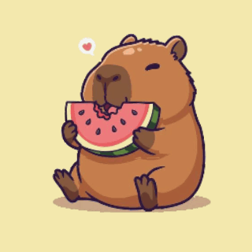
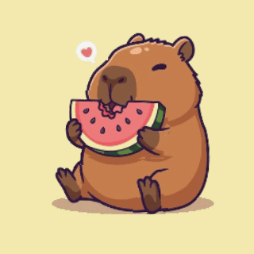
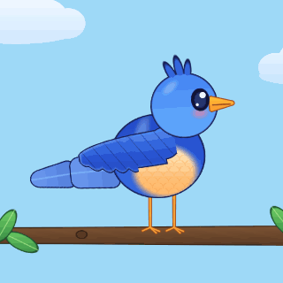
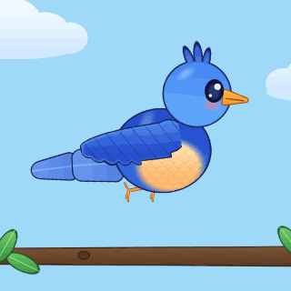

# Animation Toolkit — AI skill + procedural animators for Unity

Describe a motion in plain words ("make this capybara eat the watermelon happily", "idle and fly for this bird") and an AI agent (Claude Code, Cursor) builds it in Unity from a small runtime library — **no Spine, no DOTween, no paid APIs**, and it stays WebGL / playable-ad friendly (no reflection, coroutines or physics).
Give it a **flat image** and it cuts the art into layers without gaps, then animates them.

*Tiếng Việt: skill giúp AI tự làm animation trong Unity từ mô tả bằng lời — kể cả khi chỉ có một ảnh tĩnh (AI tự cắt layer rồi animate), kèm bộ công cụ kiểm tra art có bị hở khi chuyển động hay không.*

## Demo

Every GIF below is rendered from a scene in [`Samples/`](Samples) by the toolkit itself (`GifRecorder`), each one a seamless loop.

| | |
|---|---|
| <br>**Capybara — `Eat`**<br>chewing snout, bites of watermelon, whole-body bob, happy feet | <br>**Capybara — `Happy`**<br>same rig, faster and bouncier (second named animation) |
| <br>**Bird — `Idle`**<br>breathing, head tilt and pecks, wing shuffle, tail sway | <br>**Bird — `Fly`**<br>asymmetric wing flaps, lift-off, legs tucked, tail flutter |
| <br>**Mermaid**<br>tail fin wag with a second flutter layer, subtle breathing | |

How each one was made:
- **Capybara** — a single flat PNG (no layers, no alpha). The skill cut it into base / snout / watermelon + hands / feet / heart / shadow, filled the holes it left, and animated them. `AnimGapCheck` then verified the motion opens no gaps. See [`AI-Skill/examples/capy-eating-watermelon.md`](AI-Skill/examples/capy-eating-watermelon.md).
- **Bird** — generated vector-style art (one sprite per part), two states (`Idle`, `Fly`) in an `AnimStateSet` with cross-fade.
- **Mermaid** — one sprite sheet cut into base, tail fin and two face patches (open / closed eyes).

## What's in the box

| Part | What it is |
|---|---|
| **AI skill** — [`AI-Skill/`](AI-Skill) | `SKILL.md` + references + templates + worked examples. A method that works for *any* motion: decompose into primitives → build → measure → look → report. |
| **Runtime** — [`Runtime/`](Runtime) | Additive animators that stack on one object: Sine, Swing, Breathing, Floating, Tween, PoseSequence (keyframes), Jump (squash/stretch), Orbit, WalkCycle, Flap, chain waves (tail, hair), SecondaryMotion (spring), Blink, FacialExpression. `AnimKit` one-liners. **`AnimStateSet`**: several named animations on one object with cross-fade, Loop, Time Scale. |
| **Editor tools** — [`Editor/`](Editor) | **Animation Viewer** window (drag an object in, pick an animation from a dropdown, scrub a timeline, see motion curves), Spine-style `AnimStateSet` inspector, `ClipBaker` (to `AnimationClip`), `AnimGapCheck` (art QA), `GifRecorder`. |
| **Samples** — [`Samples/`](Samples) | `CapyAnimTest`, `BirdAnimTest`, `MermaidTest` scenes. |

## Quick start

1. Copy this folder to `Assets/AnimationToolkit` in a Unity project. Developed and tested on **Unity 2022.3** with the built-in render pipeline; other versions are untested.
2. Open **Tools ▸ Animation Toolkit ▸ Animation Viewer**, press **Cài skill cho Claude Code** (top-right) — it copies `AI-Skill/` to `.claude/skills/unity-animation-toolkit`.
3. Open a sample scene (`Samples/CapyAnimTest.unity`), select the `Capy` object. In the Inspector pick **Animation: Eat / Happy**, toggle **Loop**, change **Time Scale** — in edit mode it plays right on the object.
4. Ask your agent (with the Unity MCP connected):
   > `/unity-animation-toolkit` make this capybara sit and happily eat the watermelon — the still image is in `CapyArt`
   >
   > `/unity-animation-toolkit` bird with two animations: flap-in-place flying and an idle, generate nice art

Or code it yourself:
```csharp
AnimKit.PopIn(button);                                   // overshoot pop
AnimKit.Bounce(cat, 0.5f);                               // anticipation → air → landing, squash & stretch
AnimKit.Keyframes(head, AnimLoopMode.Loop,               // anything irregular
    AnimKit.Key(0f, Vector3.zero), AnimKit.Key(0.3f, Vector3.zero, -12f), AnimKit.Key(0.6f, Vector3.zero));
bird.GetComponent<AnimStateSet>().Play("Fly");           // cross-fades between named animations
```
API reference: [`AI-Skill/references/unity-animation-api.md`](AI-Skill/references/unity-animation-api.md) · recipes: [`recipes.md`](AI-Skill/references/recipes.md).

## How it works

- **Additive channels.** Every animator adds an offset on top of the rest pose (delta-based), so animators stack, disabled ones cost nothing and the pose is restored exactly. Periodic motion is exactly loopable and bakeable.
- **Cutting flat art** ([`splitting-flat-art.md`](AI-Skill/references/splitting-flat-art.md)). Cut only parts with a real boundary; every moving layer gets an overlap ring of original pixels and content under what occludes it (snout under the melon, the shadow as a full ellipse); holes in the base are filled from fur colour; motion at joints is kept to ~2 px and liveliness goes into whole-body motion.
- **Quality gates.** `AnimGapCheck.Run` plays every animation frame by frame and counts new cracks/holes (including the ground layer); `AuditLayers` finds junk fragments that would fly along with a layer; `RenderOnly` shows the base alone. The skill requires these *and* a look at the result.

## Regenerate the demo GIFs

```csharp
// Editor, scene with the sample open. state index, loop seconds, frame delay (1/100 s), size px, camera centre, ortho size, path, pre-roll
AnimationToolkit.EditorTools.GifRecorder.Record(GameObject.Find("Capy"), 0, 3.0f, 5, 320,
    new Vector2(0f, 1.12f), 1.3f, "Assets/AnimationToolkit/Documentation~/capy_eat.gif", 0.5f);
```
Animators are snapped to the loop length so the GIF loops cleanly; random ones (blink) are muted while recording; everything is restored afterwards. The recorder warns when the fastest animator has fewer than 6 frames per cycle (it would strobe) — use a smaller frame delay (3 = 33 fps) for fast loops such as wing flaps. `GifRecorder.SaveSheet` tiles consecutive frames into one PNG for inspecting a motion frame by frame.

## Known limits

- Per-part motion needs separate sprites/Transforms with pivots at joints (the skill explains how to cut flat art and what to ask an artist for).
- Cut-from-flat art keeps the source resolution; small or pixel-style sources look jagged when scaled. Parts without a real boundary (e.g. an ear the same flat colour as the head) are left static.
- Animating a Transform that other code overwrites absolutely each frame drifts — animate a child.
- Blink, sprite swaps and alpha are live-only (not baked).
- **Not yet verified in an actual Luna build.** The Editor windows were checked through logic and scene views, not by screenshots of the windows themselves.
- Sample art (`CapyArt`, `MermaidArt`) is included for demonstration only — bring your own art for real projects.
